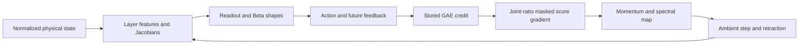

# Sepclip microscopy: actual weights, credit and physical feedback

This report is active. Actual layer V2, NorMuon physical effects, exact first-gradient reconstruction and parity-gated internal optimizer reconstruction remain pending. Completed evidence has not identified an update that learns an 18–20k policy. The central distinction is between moving weights, moving action distributions and improving the full feedback controller.

## Controlled training outcomes

Primary scores average episode-return events in the inclusive 7.7M–7.9M window. Final100 is separate. These are seed 1 HalfCheetah-v4 CUDA runs; all local work uses mlq maxParallelRuns=1. Compound packages and one seed limit causal attribution.

| Experiment | Primary | Final100 | Compared with matched control |
|---|---:|---:|---|
| Adam control | 8308.73 | 8281.18 | Baseline |
| Rollout-clock full-rate Anvil | 8781.57 | 8600.53 | +5.69% versus Adam |
| Fresh parity-gated NorMuon | 8072.72 | 8189.45 | Exact historical same-seed execution parity |
| v14 additive pre-RMS Adam | 8376.90 | 8495.27 | +0.82% |
| v14 additive pre-RMS Anvil | — | — | Cancelled after sustained inferiority at6.056M |
| v14 additive pre-RMS NorMuon | 4972.43 | 4976.18 | −38.40% |
| v15 intrinsic transport Anvil | 8250.58 | 8382.65 | −6.05% |

The cancelled Anvil run's matched 4M trailing200k score is4026.61. Its incomplete tail100 = 5165.96 is descriptive only. The v14 package changes signed projection, two additive pre-RMS blocks, free body weights and residual mixing together; it increases actor parameters by 40.13%. There are seven actual body matrices. The v15 package changes direction, amplitude and history geometry together. The additive body is free and is not retracted onto the old unit axes. Its matrix-optimizer regression therefore cannot be attributed directly to that absent body retraction. Removing constraints while changing other architectural mechanisms also does not isolate whether the original constraint helped. These negative outcomes reject the tested packages, not one isolated component. Exact benchmark receipts are [v14](../sepclip_prescription_v14/prescription_v14_scores_execution_receipt.json) and [v15](../sepclip_prescription_v14/prescription_v15_scores_execution_receipt.json).

The fresh NorMuon run is not an independent replicate: all 7,964 returns and 28 shared non-timing scalar series equal the historical run. Its 20-step warm CUDA state/gradient/parameter parity makes a gross silent port mismatch less plausible; it does not establish efficiency.

## The chain from weight to return

PPO supplies `A * ratio * score * active_mask`. Positive advantages stop above the upper ratio bound; negative advantages stop below the lower bound. The other tails remain active. Logged clip fraction is not inactive-gradient fraction. All six actuators share one ratio, so one coordinate's likelihood change can deactivate the whole sample. Ten actual updates hold credit fixed while ratios, masks, scores, Jacobians and moments evolve.

For fixed continuation, ideal smooth Beta shape credit is `Cov(Q,log U)` and `Cov(Q,log(1−U))`; softplus derivatives map that covector into logits. Matrix gradients sum signed credit-weighted outer products through the complete network. Their singular vectors are statistical modes, not automatically useful gait modes. State-only baselines cancel in exact unclipped importance-weighted expectation at any iterate. Finite sampling, sign-dependent clipping and action-dependent future critic error remove the simple cancellation argument. Explained variance against bootstrapped targets does not certify this score-weighted credit. With a fixed matched reward law and value error e = V_learned − V_true, where V_true is the exact value of the SAME continuation policy rather than an optimum, the infinite GAE error is `−e_t + gamma*(1−lambda)*sum[k>=0](gamma*lambda)^k * e_(t+k+1)`, assuming convergent errors and a vanishing terminal term. For H unmasked steps and q = gamma*lambda, the finite error is `−e_t + gamma*(1−lambda)*sum[k=0..H−1]q^k * e_(t+k+1) + q^H * e_(t+H)`. Reset/truncation boundaries alter this identity. The first term is the state-only baseline; the remaining future and terminal errors can depend on the action. Changing online normalization requires matching time/normalizer-indexed reward and value definitions; different reward laws add reward differences and cannot be called pure critic error. This identifies what a critic audit must measure, without establishing critic bias as the cause here.

Normalization removes branch-radial derivatives through `(I−y*y^T)/||b||`. Away from a zero or exactly opposing branch, the old actor's unit-direction residual is an angular bisector: shrinking a raw branch cannot turn off its normalized contribution. SiTU's nonhomogeneous gate restores some amplitude information; actual states reject a globally even or near-origin approximation. A responsive cap derivative need not imply a responsive complete gate derivative. A unit-row head with nonzero learned gains can locally represent a free affine head, so its constraint alone is not a general capacity ceiling. The measured old initialization logitRMS changes from .01072 to 1.07204 after head-row normalization, and 1.06892 after all projections: normalization cancels the intended .01 head scale. This changes startup gradient transport, but no completed isolated initialization intervention identifies it as the later score bottleneck.

## The optimizer's geometry

NorMuon lookahead is `(1−mu²)*G + mu²*v_previous`; immediate coefficients .2775 at mu=.85 and .0975 at mu=.95 precede the nonlinear cascade and adaptation. They are not fractions of useful policy movement. Anvil's slow rail updates only on the first fresh-rollout gradient, using the rollout-matched decay, then holds through later updates. Lane second moments track cascade power rather than raw gradient variance. Anvil and NorMuon also differ in beta2 and final BF16 requantization. Actual source and state conventions matter.

An ideal polar factor maximizes gradient pairing under a matrix operator-norm budget. It does not generally optimize fixed policy Fisher cost. In an illustrative SPD Kronecker metric, the fixed-cost optimum is proportional to `Cout^-1 G Cin^-1`; even whitened polar solves a different norm problem. Actual policy cost has cross-layer blocks. Diagonal bank calibration therefore cannot generally repair direction.

Polarization and tangent projection do not commute. Normalizing `W−eta*D` leaves first-order motion `−eta*P_W(D)`. A verified2×2 example turns normal credit into tangent movement through polar preconditioning; Adam can do so too. A previous tangent momentum need not be tangent now, and projection is not exact parallel transport. These mechanisms are algebraically real but not demonstrated causes of the score gap.

Existing captures store preupdate moments and ten clipped gradients/ambient/retracted deltas. They do not directly save intermediate rail/cascade/lane histories. The new forensic will require every reconstructed delta and the exact endpoint to agree before interpreting those histories. No hypothetical optimizer proposal is accepted as an actual update.

The first-gradient bridge restores the independently saved private CUDA shuffle state and reconstructs the exact first full-batch permutation. The pinned source advances this generator only during optimizer minibatching, so the preceding rollout does not change it. Acceptance requires the same compiled full PPO loss, backward and one separate foreach clipping call for each trunk to reproduce every recorded actor and critic gradient bitwise. Only then is a separate compiled actor-only ascent covector compared with the complete negative recorded actor-loss covector, using one full-actor common scale and residual. These are stored-action/GAE surrogate gradients, not a physical PG oracle; reconstructed unclipped norms and the fitted scale were not independently saved. The independently reviewed 23 CUDA contracts and five actual-capture measurements remain queued ([preparation](../sepclip_prescription_v14/first_gradient_v1_preparation_receipt.md), [review](prescription_first_gradient_v1_independent_static_review.md)).

## Layer and chart measurements

Historical layer audits replay one full-batch next-rollout proposal over 512 states, not the actual first/ten-update trajectory. Corrected FP64 KL on actual rounded FP32 shapes removes 36/168 negative FP32 values. At4M, finite KL/Fisher ratios are approximately.9971–1.0155. Joint cost is 3.34–4.53 times the isolated-bank sum; reinforcing cross terms contribute 70–78%. This is aligned functional movement, not demonstrated duplication or harm. Mean-only movement accounts for 99.5–100.8% of cost with a small concentration term and cross term, rejecting a simple concentration-waste story for these proposals.

Actual v14 chords use all 16,384 states and 18,584 actor parameters. Independent review finds adjacent h=1/.5 alpha/beta channel errors ≤.3474% and direction errors ≤.5853%. Adam8M's tiny first chord deteriorates at smaller fractions from rounding: choosing the smallest h would falsely strengthen a numerical claim. Acceptance covers aggregate captured directions, not every layer or shape-floor coordinate.

FisherV2 preserves all 18 original strict test bodies and prepares 44 CUDA cases. It is designed to repair measurable CUDA FP64 trigamma error 5.50e−10 against a1e−13 uniform fixture using longer recurrence, stable differences and conditional mode withholding. Its scalar budget does not certify JVP, Gram accumulation, KL or sampler laws. Recurrence and asymptotic identities follow [NIST recurrence](https://dlmf.nist.gov/5.15.E5) and [NIST expansion](https://dlmf.nist.gov/5.15.E8). Execution remains pending.

Chart arithmetic rank does not establish usable finite movement: historical fits at budget .001 produce actual KL .358–769.8; recovered actual-step fits overshoot by thousands to tens of millions. No chart candidate is selected.

## What physical credit and feedback resolved

Dense first-action probes use 32 own states, 16 first actions, two independent complete action/continuation replicas andH1/16/64/256/512. Full integration-state restoration, recorded normalization, transitions and GAE reconstruction pass. The full gradient field remains unreliable. Anvil8M/H512's single selected state contributes 105.92% of Euclidean and 117.84% of dual cross-replica pairing; the other 31 collectively contribute negatively. Deleting it after inspection would bias selection.

A fixed actual direction can be better resolved than the whole field. Six of 144 objective/motion contrasts pass the pointwiseR2 relative-precision rule, all correlated negative versions of Anvil8M/H512 endpoint first-action credit. Normalized total-JVP pairing is−1.118e−5[−1.558e−5,−6.783e−6]. No raw-objective scalar, first-update scalar or paired horizon-tail-increment contrast passes that precision rule. This is exploratory scalar first-action smooth-score evidence, not exact all-time PG or family-adjusted efficiency.

Seven-arm actual-policy interventions distinguish full change, t0-only change and later-only change. `Full = t0 + later + interaction` holds exactly. Interaction includes the changed state and the later actor's response to it; it cannot be assigned to one layer or critic by arithmetic.

| v14 own-stateH512 sampled endpoint | Raw discounted gain | Pointwise95% t3 interval |
|---|---:|---:|
| Adam4M | +.035 | [−3.975,+4.046] |
| Adam8M | +3.460 | [+.384,+6.535] |
| Preserved Anvil4M | −3.208 | [−5.935,−.481] |

These four-replica intervals condition on 32 fixed states. Many arms, horizons and objectives were examined without family adjustment; both apparent endpoint signs fail even a hypothetical two-test Bonferroni threshold. All raw undiscounted endpoint effects are unresolved. Different own occupancies/normalizers prohibit cross-optimizer efficiency comparisons. Adam8M mean endpoint loses −8.618 while mode gains +10.706; Anvil4M mean gains +3.476 while mode loses −3.898. Deterministic control is not sampled control. Old-v12 mode uses intended-logit excess, while v14 and the strong reference use actual rounded-shape mode; their finite-precision deterministic conventions differ. Sampled signs largely follow discounted velocity contributions, not direct cost; that is algebra, not contact attribution.

Old Anvil8M has unresolved full gain +2.784[−3.894,+9.462], negative t0-only gain −8.631[−10.327,−6.935] and positive interaction +6.842[+2.264,+11.419]. All-time score pairings remain unresolved. Its first-action local scalar is ~3,000× smaller than the finite t0 secant. The smooth-score oracle uses FP64 normalized rewards, whereas physical replay uses clip-then-FP32 rewards. The producer panels share the same replicate-seed formula with different draw layouts; independent streams and paired ratio uncertainty are not certified. Matching signs does not validate slope magnitude, curvature or full feedback credit.

One exact endpoint fraction would identify only its finite secant. Local slope needs resolved nearby paired secants with a useful precision/quantization plateau; nonlinearity needs same-replica `G(f)−2G(f/2)`. First-action credit compares with t0-only response, all-time credit with full response. No additional fraction probe is selected before pending layer/optimizer/first-gradient evidence. The [prospective committee decision](endpoint_fraction_probe_preconditions_committee.md) permits an honest inconclusive outcome; the magnitude gap alone does not establish curvature or compel further fraction probing.

## Objective and physical-law limitations

Stored-state surrogate and selected-state full-controller objectives can differ, but occupancy mismatch is not a demonstrated root cause. At the old actor iterate, with the initial law frozen to the old stationary law and learner occupancy equal to it under the same policy/environment/reset/normalizer kernel, with exact unclipped credit, `grad J_infinite=g_batch/(1−gamma)`. A finite horizon with an exact frozen V_old tail gives `(1−gamma^H)/(1−gamma)*g_batch`. Finite horizon alone does not break alignment. Our selected states, approximate/zero tails and later iterates do not establish these assumptions.

The diagnostic action law uses truncated inverse-CDF quantiles, rounded shapes and native FP32 clipping. Rare clamp atoms occur. Smooth Beta score is not a certified score of the complete rounded/clipped generator. Small atom mass or zero observations does not bound score bias. Finite paired interventions remain measurable under the stated law. Raw, normalized, undiscounted and frozen-critic-tail objectives stay separate; frozen approximate tails are not true infinite returns. In physical replay, gamma^H times the FP32 terminal value rounds to FP32 before FP64 accumulation; that numerical law is not critic bias. Discount factors are not tail-bias bounds.

## Why10k is not20k

The historical reset-evaluation mode controller reaches ~10,207 at 10.58m/s; a separately recovered gait evaluation produces 9,946 under a different protocol. Holding the historical trajectory fixed, removing its ~373 direct control penalty cannot supply the 9,793-point gap to 20k. Its sample→mean contrast is 9,030.22→10,030.00, with mode adding ~177. Those controllers change future trajectories; the differences are not universal sampling-loss bounds or isolated direct-cost effects. The remaining gap requires better learned motion and feedback; more weight movement or boundary torque does not prove that improvement.

A validated 50M stronger PPO comparator, with the same1+softplus Beta law, has 1,000-step×16 reset-evaluation physical returns 14,925.93 sampled, 15,769.63 mean and 16,173.90 mode at 15.33/16.15/16.60m/s. These are not primary trailing-window training scores. For total concentration kappa, the shape floor implies maximum physical-mean magnitude 1−2/kappa; a mean near .98 needs kappa above100. Head gains can grow and the mode can approach boundaries, so this is conditioning and a mean/variance coupling constraint, not a fixed ultimate action ceiling. It falsifies a universal Beta 10k ceiling. Duration, architecture and historical execution are unmatched; it cannot isolate the 8M bottleneck. Strong TD7 scalar logs lack saved actors. A20k optimum is unknown.

In the gait/action-direction probes, no positive aggregate first-action intervention gain has a pointwise 95% interval excluding zero; positive means exist but remain unresolved. Contacts sampled at final substeps every .05s are rare and aliased; they cannot identify true flight, stance impulse, stride phase or a gait basin. The probes perturb native first actions and group observed contacts; no direct contact-mechanism intervention is certified or selected.

## Preservation and completion requirements

Failures/skips and unrelated work remain preserved. New versions repair diagnostic contracts, tangent storage, one missing test argument and trigamma precision without changing frozen trainers. Two inherited NorMuon layer output collisions were caught and cancelled before execution, then replaced with distinct paths; nothing was overwritten. Source acceptance distinguishes actually imported frozen pins from incidental broad-inventory drift. Older executions without pre-run checkpoint pins retain that limitation. First-update banks reconstructed from old weights plus FP32 delta are not independent saved first models.

The required remaining work is terminal queue supervision, actual layer and NorMuon empirical review, exact first-gradient reconstruction, parity-gated optimizer forensics, evidence-gated adjudication and final independent report validation. No new training candidate currently passes the gates. [Investigation report](investigation_report.json), [readiness](diagnostic_readiness.json) and [mechanistic model](mechanistic_model.json) retain detailed numerical receipts, provenance and failure history. The previous synthesis was archived byte-for-byte before replacement work began.
