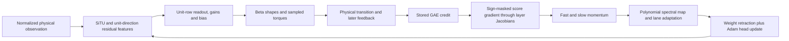

# How the current learner can plateau despite a correct polar optimizer

This is an analytical synthesis of the investigation as of the accepted historical-layer audit and dense-gradient contract validation. It distinguishes demonstrated behavior, exact mathematical mechanisms, and unresolved attribution. The investigation remains active. No TD7 training was submitted for this analysis.

## The performance gap is a motion gap

The best established rollout-clock Anvil result improves the primary matched trailing window by about5.7% over Adam, rather than demonstrating a large optimizer advantage. In separate frozen-policy evaluation, its strongest deterministic mode policy scores approximately10,207 at10.58m/s. Removing its entire direct torque penalty would recover only about373 points. Sampling versus deterministic control explains roughly another thousand points, depending on the checkpoint. Neither accounts for the desired20k result.

Existing local TD7 logs reach approximately17–18k, with different evaluation/checkpoint protocols and no saved actors. They establish a substantially stronger local score reference, not a known mathematical optimum. A saved longer-trained PPO actor around14.5k is a possible physical comparator, but its50M training and different architecture preclude causal attribution by score alone.

The remaining question is how the current actor learns a different motion pattern: displacement per stride, stride period, contact timing and state feedback. More parameter motion or more boundary torque does not automatically improve those quantities.

## The actual chain

Every arrow matters. The optimizer receives a gradient of an estimated probability surrogate, not an oracle direction for faster locomotion. A correct spectral map cannot correct upstream credit errors, choose a different objective, or know whether its surviving functional direction changes useful gait feedback.

## What the architecture does to gradients

For a nonzero branch output b, normalization has derivative `(I-y*y^T)/||b||`, where y is its unit direction. It discards feature-radial changes and rescales transverse changes. A homogeneous branch also loses its input-radial derivative. SiTU's nonhomogeneous gates restore some amplitude information; actual visited statistics reject treating the actor as globally even or uniformly near the quadratic origin.

The second residual stage sums two unit directions. Its final feature is their angular bisector. A smaller raw branch magnitude cannot continuously turn that branch off after normalization. Near-opposing directions can amplify the Jacobian through a small sum norm, although their prevalence and physical importance are unmeasured. This is a specific architectural distinction from an additive pre-RMS identity stream, not a proven capacity failure.

The full SiTU gate derivative can cancel near gate input−1.219 despite a responsive tanh cap. Cap saturation, sigmoid saturation and full credit-bearing derivative are different quantities. A value histogram spanning that point does not establish gradient starvation: credit weighting and the other up/down paths matter.

The actor head also needs careful interpretation. With nonzero gain, a unit-row weight plus gain and bias can locally represent a free affine head. Its constraint alone is not a generic readout-capacity ceiling. Coordinated weight/gain/bias updates can reproduce free affine SGD at initialization; later mobility becomes anisotropic, and Adam's distinct histories change that coordination. Body constraints lack the same general compensating gain route.

## What PPO supplies to the optimizer

At a stored state/action, the ascent gradient is `A * ratio * score * active_mask`. Positive advantages stop contributing above the upper ratio bound; negative advantages stop contributing below the lower bound. The other two tails remain active. Logged ratio clip fraction therefore differs from the inactive-gradient fraction.

The score includes both Beta log-action derivatives and the current network Jacobian. Across ten epochs, clipping selection, importance weights, score derivatives and Jacobians all change. Advantages remain fixed during those epochs, even as the critic updates.

Clipping uses the joint six-action ratio: its log is the sum of all six per-coordinate log ratios. A sufficiently large change in one actuator can deactivate the whole sample's gradient, including other actuator contributions. This is not independent per-actuator clipping, and joint return credit is not generally separable because torques interact through contact and feedback. The measured4M joint Fisher costs imply linearized log-ratio RMS approximately.085 and.155 for the rollout-clock half/full proposals. These scales characterize likelihood motion, not a Gaussian tail law or an inactive-gradient fraction; score tails, state heterogeneity and advantage-sign correlation remain essential.

For a fixed continuation policy, an exact Beta shape gradient is a return/log-action covariance: `dE[Q]/dalpha = Cov(Q,log U)`, and similarly for beta and log(1−U). In six-action control this is a vector-action conditional return, not six separable torque problems. The covariance may reflect contact timing and future state response as much as immediate torque.

A state-only baseline cancels in an exact unclipped importance-weighted expectation at every actor iterate, not only the first. Finite samples need not cancel. Sign-dependent clipping generally breaks the cancellation and can change its own active region when estimated advantages change sign. Future-state critic errors in GAE can already be action-dependent before clipping. These distinctions prevent equating critic target accuracy with actor credit accuracy.

## What momentum and polarization change

For NorMuon, the lookahead entering the cascade is `(1-mu^2)*current_gradient + mu^2*previous_velocity`. At momentum.95 its current-gradient coefficient is.0975; at.85 it is.2775. These are pre-cascade coefficients, not fractions of the final policy motion. The stronger newer.85 run and improved rollout-clock Anvil support examining field lag, but source differences and coupled algorithm changes prevent treating every comparison as an isolated momentum intervention.

An ideal polar factor maximizes gradient pairing under a matrix spectral-norm constraint. It need not maximize improvement at fixed policy Fisher cost or physical return cost. Flattening singular values can strengthen weak useful modes or weak noisy modes. The actual finite polynomial map, BF16 rounding, lane adaptation and epsilon floors must be retained when assessing this effect.

Polarization and retraction do not commute. A verified2x2 example shows a pure radial ambient gradient with zero constrained gradient becoming tangential motion after polarization and row normalization. This establishes a possible transport effect; it does not establish harm, dominance in the actor, or superiority over Adam. Adam's elementwise preconditioning can also convert radial components into tangent motion.

## What the new layer measurements establish

Six historical snapshots now have finite positive exact Beta KL, evaluated in FP64 on actual rounded FP32 shapes. At4M, KL/Fisher ratios range approximately.9971–1.0155; late ratios agree within.0452%. Local joint policy displacement is therefore numerically well characterized at those proposals.

Joint Fisher cost is3.34–4.53 times the sum of isolated diagonal costs. Cross-layer reinforcement contributes approximately70–78% of the total. The layers are often spending displacement on aligned functional directions; isolated parameter or layer budgets cannot characterize the deployed update. This reinforcement is not itself an error: ordinary gradient steps can also move shared outputs coherently.

For fixed bank response directions and reliable directional credits c, choosing scalar bank amplitudes at a fixed joint quadratic cost uses the full bank Gram, not its diagonal. Its ideal local solution follows the inverse-Gram credit direction where well defined. This is a diagnostic reference, not a proposed validated optimizer: ill-conditioned cancellations, noisy credit and finite-retraction curvature can invalidate the apparent gain. Cross reinforcement alone does not establish duplication, an excessive learning rate, or a harmful direction.

At4M, actual physical mean-action RMS motion is approximately.0066–.014; late motion is approximately.000048–.000108. Schedule, policy, states and optimizer history all change, so late snapshots cannot stand in for the geometry governing earlier learning.

The mean/concentration decomposition assigns about99.5–100.8% of joint Fisher cost to mean-only motion, with small concentration cost and a cross term. This argues against the simple claim that the optimizer mainly spends its budget on concentration. It does not establish that its mean direction improves physical return or that small concentration changes cannot affect contact noise substantially.

## Coordinate conditioning is not a physical oracle

Near an asymmetric Beta boundary, bounded logit steps can produce very small mean changes. Exact Fisher correction cancels smooth coordinate scaling locally, while intrinsic KL-limited mean movement still shrinks with the endpoint gap. Shape floors impose a maximum reachable variance at a near-bound mean, not a positive variance floor or a10k gait ceiling.

The proposed mode/excess-precision chart is not the mean/total-concentration chart used in some diagnostics. Precision changes can move mean. The covector and Fisher must transform into the actual proposed coordinates, including cross terms. Its anchored readout also changes the later state-dependent function family, despite matching the initial policy and hidden Jacobian. Any benefit would need to distinguish expressivity from conditioning.

## How these mechanisms could affect gait

For deterministic mean/mode actions, a local state perturbation propagates through `A_t = f_x + f_a*J_action,state`; a weight update injects `f_a*J_action,weights*Delta_weights`. Future products of these feedback matrices can reinforce, damp or reverse the effect. For sampled actions the corresponding formula is conditional on sampling noise; deterministic mean feedback is not the full stochastic return derivative.

A gait can become faster through increased displacement per cycle, shorter period, or both. The relevant weight direction is its phase-resolved forcing paired with future physical credit. A local optimizer can improve sampled action probabilities without producing that direction. A faster motion pattern may also require nonlinear contact/period changes outside the validity of a local prediction. No current measurement establishes a basin barrier, particular Floquet multipliers, or a unique gait bottleneck.

## What would locate the missing improvement

The learner averages its gradient over uniformly weighted stored states. An all-time discounted physical objective instead uses its propagated state occupancy and remaining-horizon credit. Their gradients can disagree even with an exact critic. The conditional first-action and full closed-loop diagnostics answer different questions and must not be conflated.

Full-field oracle noise is not the only reliability criterion. A fixed actual optimizer direction can have a resolved scalar return effect while the full estimated gradient has poor replica cosine. Alternative directions fitted from that same noisy field still need independent held-out evidence. Positive pairwise cross-energy alone does not establish confidence, and pairs sharing replicas are not independent samples.

The attribution sequence is therefore:

1. Specify objective, reward units, initial-state weighting, terminal tail and sampling law.
2. Resolve physical credit along the direction being tested.
3. Compare stored PG and actual combined optimizer motion at matched joint policy cost.
4. Validate real weight-chord linearization and finite closed-loop effects.
5. Attribute a restriction to credit, optimizer transport or reachable feedback only when the earlier links are controlled.

Current evidence supports a layered explanation to investigate, not a demonstrated single cure. The analytical work has narrowed several false explanations and clarified the exact transformations involved. It has not yet shown why a particular corrected update would learn an18–20k gait.

Sources: `layer_historical_fp64_measurement_review.md`, `root_analytical_transport.md`, `ppo_epoch_credit_appendix.md`, `independent_beta_geometry_appendix.md`, `committee_periodic_gait_response.md`, and the independently reviewed analytical notes referenced by `mechanistic_model.json`. The38 passed dense-gradient contracts validate implementation behavior, not resolved physical-gradient signal.
